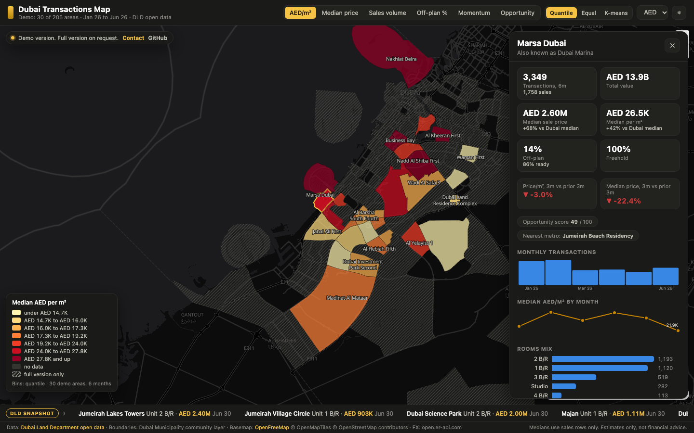

# Dubai Transactions Map

An interactive map of Dubai's registered property market that turns Dubai Land Department open data into prices, momentum and an opportunity score for every community.

**Live demo: https://artinbahmani.artin-bahmani0.workers.dev/dubai-transactions-map/**

The live demo is a limited preview: 30 of 205 areas carry statistics, figures are rounded and the transaction ticker is a fixed snapshot. Every area, the live DLD feed, ranked area tables and data exports are part of the full version.

## What it does

- **Six market views on one map.** Communities are colored by median AED per square meter, median sale price, sales volume, off-plan share, price momentum or opportunity score, with quantile, equal interval or k-means color bins.
- **Area intelligence on click.** A slide-in panel shows transactions and total value, medians against the Dubai-wide median, off-plan and freehold split, momentum over the last 3 months versus the prior 3, nearest metro station, monthly volume and price trends, rooms mix and top projects.
- **Opportunity score.** A 0 to 100 composite that ranks areas on price momentum, discount to the Dubai-wide price per square meter and liquidity, with a minimum-sales guardrail so small areas cannot top the board on noise.
- **Live transaction ticker.** The latest registered deals stream from the DLD open-data gateway, with a clearly labeled fallback to the baked snapshot when the feed is slow.
- **Currency and theme switches.** Every figure converts between AED, USD, EUR, GBP, INR, RUB and IRR, on light or dark basemaps, with zoom-dependent labels for name, value and deal count.
- **Full coverage, any screen.** About 111,000 deduplicated transactions across 205 areas, matched to official community boundaries for 99.8% transaction coverage. On mobile the stats panel becomes a bottom sheet.

## How it works

A bake step pages the full transaction window from the Dubai Land Department open-data gateway, re-filters dates, removes duplicate transaction numbers and aggregates each area into a compact dataset. Price medians use sales only, so mortgages and gifts cannot distort price signals, while totals cover every transaction type. Area names are matched to Dubai Municipality community polygons; the few areas without a polygon fall back to geocoded points drawn as circles sized by volume. The browser loads the baked data and renders it with MapLibre GL on vector basemap tiles, computing color breaks, scores, labels and currency conversion on the fly. There is no backend: the whole app runs from static hosting.

## Stack

- Vanilla JavaScript, HTML and CSS
- MapLibre GL JS for the map, D3 color scales for the choropleth
- Node.js bake pipeline over the Dubai Land Department open-data gateway
- Dubai Municipality community boundaries, OpenFreeMap vector tiles
- open.er-api.com exchange rates
- Runs on any static host

Data: [Dubai Land Department open data](https://dubailand.gov.ae/en/open-data/real-estate-data/). Boundaries: Dubai Municipality community layer. Basemap: [OpenFreeMap](https://openfreemap.org), (c) OpenMapTiles, (c) OpenStreetMap contributors. Figures are estimates for information only and are not financial advice.

## Get the full version

Source code is private. To use it in your business or get the full version, contact me: artin.bahmani0@gmail.com

All rights reserved.
